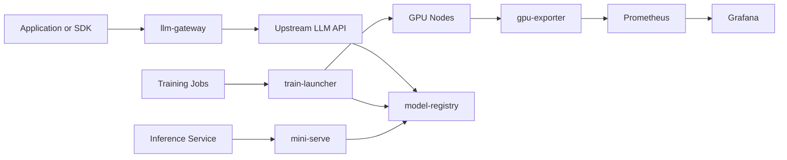

# AI Infrastructure Project Portfolio

[](LICENSE)
[](https://www.python.org/downloads/release/python-3110/)
[](https://github.com/theraihanrakibb?tab=repositories)

A curated set of **five small, production-quality AI-infrastructure projects**, built to demonstrate the breadth of
skills an AI platform / infrastructure engineer needs: **model serving, GPU observability, distributed-training
orchestration, MLOps artifact governance, and LLM API gatewaying**.

Every project is:

- **Self-contained** — minimal, pinned dependencies; runs and is fully tested with **no GPU, no network, no large model downloads**.
- **Production-shaped** — type hints, structured logging, `Dockerfile`, and a green **GitHub Actions CI** on every push/PR.
- **Documented** — architecture diagram, quickstart, API/CLI reference, and a *"Why this matters for AI infra"* section.

---

## The projects

| Project | Area | What it does | Stack | Tests |
|---------|------|--------------|-------|-------|
| [llm-gateway](https://github.com/theraihanrakibb/llm-gateway) | **LLM Gateway** | OpenAI-compatible reverse proxy with per-key rate limiting, cost caps, response caching, and provider fallback. | FastAPI · httpx · Prometheus | 20 passed |
| [mini-serve](https://github.com/theraihanrakibb/mini-serve) | **Model Serving** | Tiny inference server with dynamic batching, SSE token streaming, health/readiness probes, and Prometheus metrics. | FastAPI · asyncio · Prometheus | 10 passed |
| [gpu-exporter](https://github.com/theraihanrakibb/gpu-exporter) | **Observability** | Prometheus exporter for NVIDIA GPU metrics (parses `nvidia-smi`), graceful degradation, plus a Grafana dashboard. | prometheus-client · Grafana | 14 passed |
| [train-launcher](https://github.com/theraihanrakibb/train-launcher) | **Training Orchestration** | CLI to launch and supervise multi-node PyTorch training with fault tolerance and automatic retry. | argparse · pydantic · SSH | 16 passed |
| [model-registry](https://github.com/theraihanrakibb/model-registry) | **MLOps** | Content-addressed model/dataset registry (mini-MLflow) with a CLI and REST API, versioning, and aliases. | FastAPI · SQLite · SHA-256 | 20 passed |

> Combined: **80 automated tests passing**, 5 Dockerized services, 5 CI pipelines.

---

## How they fit together



The five form a coherent substrate for running ML reliably: **train** models and **register** them, **serve** them
with batching/streaming, **expose** GPUs to monitoring, and **gate** LLM traffic with cost and rate controls.

---

## Engineering practices (applied across all repos)

- **Conventional commits** (`feat:`, `test:`, `docs:`, …).
- **Branch protection** on `main`: no force-push, no deletion, CI (`test`) must be green before merge.
- **CODEOWNERS** set to the maintainer for review routing.
- **Reproducible builds**: pinned `requirements.txt`, `python:3.11-slim` images running as a non-root user.
- **Testable without expensive resources**: mocks/adapters for GPU, network, and model weights.

---

## Quick tour

```bash
# LLM gateway
git clone https://github.com/theraihanrakibb/llm-gateway && cd llm-gateway
python -m pip install -r requirements.txt && uvicorn llm_gateway.app:app --port 8080

# Mini inference server
git clone https://github.com/theraihanrakibb/mini-serve && cd mini-serve
python -m pip install -r requirements.txt && python -m uvicorn mini_serve.server:app --port 8000

# GPU exporter (degrades gracefully without a GPU)
git clone https://github.com/theraihanrakibb/gpu-exporter && cd gpu-exporter
python -m pip install -r requirements.txt && python -m gpu_exporter --port 9400

# Training launcher
git clone https://github.com/theraihanrakibb/train-launcher && cd train-launcher
python -m pip install -r requirements.txt && python -m train_launcher launch --spec examples/job.yaml

# Model registry
git clone https://github.com/theraihanrakibb/model-registry && cd model-registry
python -m pip install -r requirements.txt && python -m uvicorn model_registry.api:app --port 8001
```

---

## Why this portfolio

Each project targets a concrete, recurring problem in ML platforms:

- **llm-gateway** — multi-tenant LLM cost governance and protecting downstream services from retry storms.
- **mini-serve** — throughput via dynamic batching, streaming UX, and SLO probing for inference.
- **gpu-exporter** — turning the scarcest, most expensive resource (GPUs) into measurable, alertable signals.
- **train-launcher** — automatic recovery from node failures so long training jobs don't lose compute.
- **model-registry** — reproducible, deduped model/dataset versioning with safe alias-based rollbacks.

---

## License

MIT © MD RAKIBUL ISLAM RAIHAN — see [LICENSE](LICENSE).
