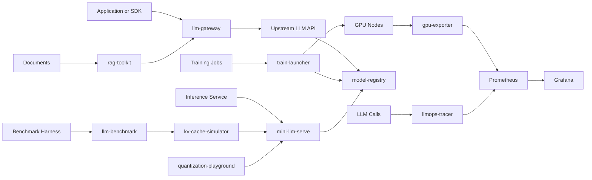

# AI Infrastructure Project Portfolio

[](LICENSE)
[](https://www.python.org/downloads/release/python-3110/)
[](https://github.com/theraihanrakibb?tab=repositories)

A curated set of **ten small, production-quality AI-infrastructure projects**, built to demonstrate the breadth of
skills an AI platform / infrastructure engineer needs: **model serving, GPU observability, distributed-training
orchestration, MLOps artifact governance, LLM API gatewaying, KV-cache / prefill-decode simulation, LLM benchmarking,
low-precision quantization, LLMOps tracing, and retrieval-augmented generation**.

Every project is:

- **Self-contained** — minimal, pinned dependencies; runs and is fully tested with **no GPU, no network, no large model downloads**.
- **Production-shaped** — type hints, structured logging, `Dockerfile`, and a green **GitHub Actions CI** on every push/PR.
- **Documented** — architecture diagram, quickstart, API/CLI reference, and a *"Why this matters for AI infra"* section.

---

## The projects

| Project | Area | What it does | Stack | Tests |
|---------|------|--------------|-------|-------|
| [llm-gateway](https://github.com/theraihanrakibb/llm-gateway) | **LLM Gateway** | OpenAI-compatible reverse proxy with per-key rate limiting, cost caps, response caching, and provider fallback. | FastAPI · httpx · Prometheus | 20 passed |
| [mini-llm-serve](https://github.com/theraihanrakibb/mini-llm-serve) | **Model Serving** | Tiny inference server with dynamic batching, SSE token streaming, health/readiness probes, and Prometheus metrics. | FastAPI · asyncio · Prometheus | 10 passed |
| [gpu-exporter](https://github.com/theraihanrakibb/gpu-exporter) | **Observability** | Prometheus exporter for NVIDIA GPU metrics (parses `nvidia-smi`), graceful degradation, plus a Grafana dashboard. | prometheus-client · Grafana | 14 passed |
| [train-launcher](https://github.com/theraihanrakibb/train-launcher) | **Training Orchestration** | CLI to launch and supervise multi-node PyTorch training with fault tolerance and automatic retry. | argparse · pydantic · SSH | 16 passed |
| [model-registry](https://github.com/theraihanrakibb/model-registry) | **MLOps** | Content-addressed model/dataset registry (mini-MLflow) with a CLI and REST API, versioning, and aliases. | FastAPI · SQLite · SHA-256 | 20 passed |
| [kv-cache-simulator](https://github.com/theraihanrakibb/kv-cache-simulator) | **Inference Efficiency** | Simulator for KV-cache eviction policies and prefill/decode disaggregation, with TTFT/TPOT metrics. | typer · numpy | 20 passed |
| [llm-benchmark](https://github.com/theraihanrakibb/llm-benchmark) | **Benchmarking** | LLM inference benchmark + eval harness measuring TTFT, TPOT, throughput, and a cost model. | typer · numpy | 16 passed |
| [quantization-playground](https://github.com/theraihanrakibb/quantization-playground) | **Low Precision** | FP8/FP4/INT8/INT4 bit-packing and a tiny numpy MLP to show quantization error vs. speed. | numpy | 34 passed |
| [llmops-tracer](https://github.com/theraihanrakibb/llmops-tracer) | **Observability** | OpenTelemetry-based LLM tracing collector with a FastAPI app and Grafana dashboard. | FastAPI · OTel · Grafana | 11 passed |
| [rag-toolkit](https://github.com/theraihanrakibb/rag-toolkit) | **Retrieval (RAG)** | Dependency-light RAG toolkit: ingest → chunk → embed → ANN search → rerank, runs fully offline. | typer · numpy · FastAPI | 35 passed |

> Combined: **196 automated tests passing**, 10 Dockerized services, 10 CI pipelines.

---

## How they fit together



The projects form a coherent substrate for running ML reliably: **train** models and **register** them, **serve** them
with batching/streaming, **expose** GPUs to monitoring, **gate** LLM traffic with cost and rate controls, and **measure**
serving behaviour with the benchmark, KV-cache, quantization, tracing, and RAG toolkits.

---

## Engineering practices (applied across all repos)

- **Conventional commits** (`feat:`, `test:`, `docs:`, …).
- **Branch protection** on `main`: no force-push, no deletion, CI (`test`) must be green before merge.
- **CODEOWNERS** set to the maintainer for review routing.
- **Reproducible builds**: pinned `requirements.txt`, `python:3.11-slim` images running as a non-root user.
- **Testable without expensive resources**: mocks/adapters for GPU, network, and model weights.

---

## Quick tour

```bash
# LLM gateway
git clone https://github.com/theraihanrakibb/llm-gateway && cd llm-gateway
python -m pip install -r requirements.txt && uvicorn llm_gateway.app:app --port 8080

# Mini inference server
git clone https://github.com/theraihanrakibb/mini-llm-serve && cd mini-llm-serve
python -m pip install -r requirements.txt && python -m uvicorn mini_serve.server:app --port 8000

# GPU exporter (degrades gracefully without a GPU)
git clone https://github.com/theraihanrakibb/gpu-exporter && cd gpu-exporter
python -m pip install -r requirements.txt && python -m gpu_exporter --port 9400

# Training launcher
git clone https://github.com/theraihanrakibb/train-launcher && cd train-launcher
python -m pip install -r requirements.txt && python -m train_launcher launch --spec examples/job.yaml

# Model registry
git clone https://github.com/theraihanrakibb/model-registry && cd model-registry
python -m pip install -r requirements.txt && python -m uvicorn model_registry.api:app --port 8001

# KV-cache / PD-disaggregation simulator
git clone https://github.com/theraihanrakibb/kv-cache-simulator && cd kv-cache-simulator
python -m pip install -e . && python -m kv_cache_sim --help

# LLM benchmark + eval harness
git clone https://github.com/theraihanrakibb/llm-benchmark && cd llm-benchmark
python -m pip install -e . && python -m llm_bench --help

# Quantization playground
git clone https://github.com/theraihanrakibb/quantization-playground && cd quantization-playground
python -m pip install -e . && python -m quant_playground --help

# LLMOps tracing
git clone https://github.com/theraihanrakibb/llmops-tracer && cd llmops-tracer
python -m pip install -e .[otlp] && python -m llmoops_trace --help

# RAG pipeline
git clone https://github.com/theraihanrakibb/rag-toolkit && cd rag-toolkit
python -m pip install -e .[api] && rag-pipeline index "docs/*.md"
```

---

## Why this portfolio

Each project targets a concrete, recurring problem in ML platforms:

- **llm-gateway** — multi-tenant LLM cost governance and protecting downstream services from retry storms.
- **mini-llm-serve** — throughput via dynamic batching, streaming UX, and SLO probing for inference.
- **gpu-exporter** — turning the scarcest, most expensive resource (GPUs) into measurable, alertable signals.
- **train-launcher** — automatic recovery from node failures so long training jobs don't lose compute.
- **model-registry** — reproducible, deduped model/dataset versioning with safe alias-based rollbacks.
- **kv-cache-simulator** — makes the memory/latency trade-offs of prefix caching and PD-disaggregation explicit and measurable.
- **llm-benchmark** — turns "is this model fast enough / cheap enough?" into reproducible TTFT/TPOT/cost numbers.
- **quantization-playground** — demystifies FP8/FP4/INT4 so you can reason about the accuracy-vs-throughput frontier.
- **llmops-tracer** — gives every LLM call a trace so latency and cost are attributable, not a black box.
- **rag-toolkit** — a transparent, testable retrieval loop you can benchmark and debug before wiring in a vector DB.

---

## License

MIT © MD RAKIBUL ISLAM RAIHAN — see [LICENSE](LICENSE).
